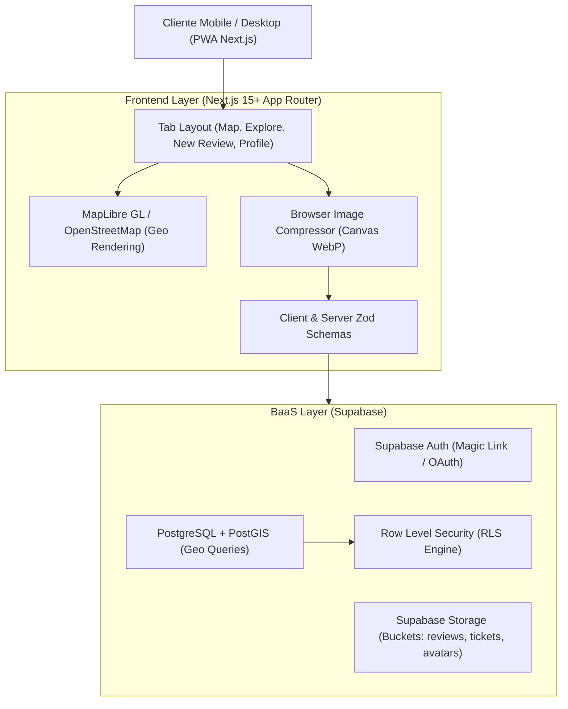

# Documento de Arquitectura de Software — Proyecto Reseñas

**Versión:** 1.0.0-draft  
**Estado:** Fase 1 / 2 — Diseño Arquitectónico Preliminar  

---

## 1. Visión General de la Arquitectura
La aplicación se diseña bajo un patrón **PWA Mobile-First** utilizando el **App Router de Next.js (React 19 / TypeScript)**, conectado a una base de datos relacional gestionada en **Supabase (PostgreSQL + PostGIS + Storage + Auth)** y estilizado con **Tailwind CSS**.

---

## 2. Decisiones Arquitectónicas Clave (ADRs)

### ADR-01: PWA Mobile-First con Next.js App Router
- **Contexto:** La app debe sentirse como una aplicación nativa en celular (gestos touch, bottom bar de tabs, viewport bloqueado a zoom involuntario), pero con accesibilidad universal web en desktop.
- **Decisión:** Desarrollar como Progressive Web App (PWA) con diseño *Mobile-First*, agregando `manifest.json`, `theme-color`, y meta tags `viewport-fit=cover`.
- **Compromiso (Trade-off):** Ahorra los costos y demoras de publicación en App Store y Google Play Store en etapas tempranas de validación de mercado.

### ADR-02: MapLibre GL + OpenStreetMap en lugar de Google Maps SDK
- **Contexto:** Se requiere visualización de mapas, geocodificación y marcadores interactivos.
- **Decisión:** Usar `maplibre-gl` con teselas de OpenStreetMap (o vector tiles abiertas tipo Stadia / Protomaps / OSM).
- **Compromiso (Trade-off):** Costo operativo $0 USD, sin tarjeta de crédito vinculada ni bloqueos por cuotas de facturación sorpresivas en etapas de desarrollo y pruebas piloto.

### ADR-03: PostGIS para Consultas Espaciales en PostgreSQL (Supabase)
- **Contexto:** Encontrar restaurantes en un radio de $X$ kilómetros desde la posición del usuario.
- **Decisión:** Habilitar la extensión nativa `postgis` en Supabase y almacenar las coordenadas en columnas `geography(Point, 4326)`.
- **Compromiso (Trade-off):** Las consultas de proximidad se resuelven en microsegundos usando índices espaciales GiST (`ST_DWithin`), evitando cálculos trigonométricos ineficientes en el servidor web.

### ADR-04: Estrategia de Prototipado "Cascarón Visual Funcional Primero"
- **Contexto:** El usuario y los stakeholders necesitan palpar de inmediato cómo se verá y comportará la app en celular antes de atar la lógica de negocio a tablas remotas de base de datos.
- **Decisión:** Implementar primero un cascarón con mock data y estado reactivo local que permita probar la navegación, los 5 tabs, el mapa interactivo y los formularios de reseña, facilitando el feedback visual inmediato.
