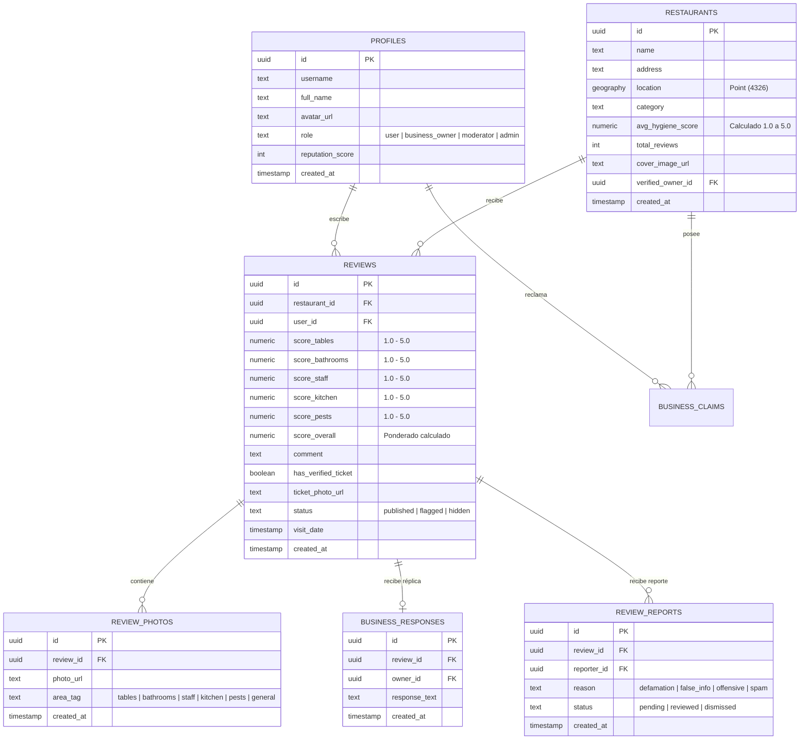

# Diseño de Base de Datos y Modelo Entidad-Relación — Proyecto Reseñas

**Motor:** PostgreSQL (Supabase) + Extensión `postgis`  
**Estado:** Preliminar (Fase 1 / 2)

---

## 1. Diagrama Entidad-Relación Conceptual

---

## 2. Índices de Rendimiento y Restricciones
1. **Índice Espacial GiST:** `CREATE INDEX idx_restaurants_location ON restaurants USING GIST(location);` para consultas ultrarrápidas de proximidad (`ST_DWithin`).
2. **Restricción de Unicidad de Reseña por Visita:** Un usuario no puede publicar más de una reseña al mismo restaurante en un margen de 24 horas para prevenir ataques de desprestigio orquestados (*review bombing*).
3. **Trigger de Actualización de IPH:** Al insertar o modificar una reseña con estado `published`, un trigger de PostgreSQL recalcula automáticamente `avg_hygiene_score` y `total_reviews` en la tabla `restaurants`.

---

## 3. Políticas de Seguridad RLS (Row Level Security)
- **`restaurants`:** Lectura pública (`SELECT`) abierta a todos. Creación (`INSERT`) permitida a usuarios autenticados. Edición (`UPDATE`) restringida al `verified_owner_id` o `admin`.
- **`reviews`:** Lectura pública para reseñas en estado `published`. Inserción para usuarios autenticados. Edición y eliminación solo por el autor de la reseña (`auth.uid() = user_id`) o moderadores.
- **`business_responses`:** Inserción permitida únicamente al usuario cuyo `auth.uid()` coincida con el `verified_owner_id` del restaurante asociado a la reseña.
- **`review_reports`:** Inserción permitida a usuarios autenticados; lectura reservada para el reportero y el equipo de moderación.
